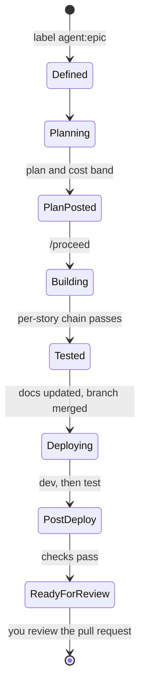

# Epic lifecycle

Live

An epic moves through a fixed set of states. Every change of state is recorded, so Forge can resume after any failure and you can see exactly where an epic is.

## The stages

1. **Defined.** Adding the `agent:epic` label activates the epic.
2. **Requirements check.** The product-manager agent compares the epic's nouns with the real entities in your code. Gaps become questions on the issue. A hard domain mismatch always stops and asks.
3. **Plan.** The epic-planner splits the epic into vertical-slice stories with dependencies, size estimates and per-story acceptance criteria. A separate, stronger reviewer model audits the plan. One readable comment is posted, with a cost and risk band.
4. **Approval.** You reply `/proceed`, or the epic carries `agent:auto-approve`.
5. **Building.** Stories with no dependencies start in parallel; dependent stories wait. Each story runs the [agent chain](agents.md): architect, QA (failing tests first), implementation, security review, infrastructure, reviewers, then validation on the merged result.
6. **Documentation.** Once every story is tested, the docs agent appends a changelog entry.
7. **Deploy.** Forge merges into your `develop` branch, your own workflow deploys to dev, and Forge reads the result. If configured, the same happens for a test environment.
8. **Post-deploy checks.** Smoke and validation steps run against the deployed environment on plans that include them.
9. **Ready for review.** Forge posts a final cost summary and opens the pull request, depending on your pull request timing setting.

## When things fail

Failures have their own paths. A failed deploy is triaged: Forge retries with a fix agent when it is safe to, and escalates to a human when it is not (for example when the log shows a credentials problem). A failed test run sends the work back to the implicated agent once. After a bounded number of attempts the epic escalates to you with an explanation and the command to run. See [Why is my epic stuck?](../help/troubleshooting.md).

## Cost along the way

Cost, tokens, model and outcome are recorded for every agent run and rolled up per story and per epic. The plan carries a cost band before anything is built. At the end, the actual cost is posted next to it. The band is informational, not a binding price.
