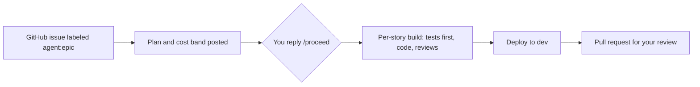

# Forge

Forge is an autonomous software delivery system. It works inside your existing codebase and takes a piece of work from a GitHub issue to a reviewed pull request, with tests, security review, deployment and an audit trail. People approve the plan and review the result. Specialized AI agents do the work in between.

## Two ways teams use it

-   **End-to-end feature delivery**

    File an epic on a GitHub issue. Forge plans it, splits it into stories, writes failing tests first, implements, reviews, deploys to your dev environment and opens a pull request.

    [Quickstart](get-started/quickstart.md)

-   **Modernization of .NET Framework systems**

    Move classic .NET Framework code to modern .NET one slice at a time, with tests that pin today's behavior and run before and after.

    [Modernization overview](modernization/index.md)

## How an epic flows

You approve the plan once and read the result. Anything an agent cannot safely decide stops and asks you, instead of guessing.

## What makes it different

- **Tests before code.** QA writes failing tests from your acceptance criteria before any implementation agent runs. The agent that writes code is never the agent that reviews it.
- **Built for existing codebases.** Forge reads your code first, builds a map and a code graph, and plans against what is already there, including the fragile parts.
- **Stacks other tools skip.** .NET Framework, WinForms and WPF, Windows services and SQL Server projects, alongside Node, React and the other [supported stacks](reference/stacks.md).
- **Auditable.** Every agent run records model, tokens, cost and outcome in a permanent ledger. Every state change is recorded.
- **Your keys.** You bring your own AI vendor key, so token charges go to your vendor.

## Status labels used in these docs

Live shipped and used in real runs.
Early access built and tested, enabled per project, not yet proven at scale.
Business and Enterprise available on those plans only. See [Plans and availability](reference/plans.md).

## Where to go next

- New to Forge: [Quickstart](get-started/quickstart.md)
- Looking up a command: [Slash commands](reference/commands.md)
- Epic not moving: [Why is my epic stuck?](help/troubleshooting.md)
- Security questionnaire: [Security overview](security/overview.md)

## More from Forgestus

- [Forgestus.ai](https://forgestus.ai/): what Forge is and how teams use it
- [Forge platform overview](https://forgestus.ai/platform.html): architecture and how the agents fit together
- [Pricing and plans](https://forgestus.ai/pricing.html): Team, Business and Enterprise compared
- [Book a Forge demo](https://calendar.google.com/calendar/appointments/schedules/AcZssZ1mQxVqet7MixvkWyWwbXtTBXqIS_a4kcb-qDxfqhldP1TamzoeIGAKPTg1IdNG2ZY890-0v5UC): talk to the team
