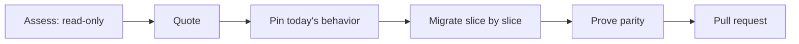

# Modernization overview

<span class="badge badge-live">Live</span> <span class="badge badge-plan">Business and Enterprise</span>

Forge moves classic .NET Framework systems to modern .NET one slice at a time, and checks each slice against the behavior of the old code. It is built for systems that pay the bills and that nobody wants to touch, and for teams that need evidence a change did not alter behavior.

Two principles run through all of it:

- **Old behavior is the truth.** If a bug exists in the old system, Forge pins it in a test instead of fixing it, so the migration does not silently change behavior.
- **Hard blockers are never auto-attempted.** Anything that cannot be migrated safely is flagged for a human instead of guessed.

## The journey



1. **[Assess](assessment.md).** A read-only analysis inventories every project, classifies difficulty, ranks risk and orders the work. Nothing is written to your code.
2. **Quote.** A cost and risk band is posted before build money is committed.
3. **Pin the baseline.** Tests capture what the system does today and run on the old .NET Framework runtime.
4. **Migrate slice by slice.** Leaf-first, in dependency order. Each slice builds and tests on both the old and the new runtime until it is cut over.
5. **[Prove parity](parity-proof.md).** The same tests run on old and new code and each side gets a report.
6. **Pull request.** Migration epics convert and verify only. They never deploy. You review the pull request and deploy on your own pipeline.

## Start a migration

On an issue in the repository, comment:

```text
/migrate
```

Forge creates a migration epic. A migration analyst inventories the solution, a plan is posted, and you approve with `/proceed` as with any epic. Migration, characterization tests and Parity Proof are available on Business and Enterprise. Windows-based epics count as two epics against the monthly allowance.

## Slice-by-slice conversion

Each slice is one story, in leaf-first order with cycle detection. Tooling starts with Microsoft's try-convert and upgrade-assistant. `packages.config` becomes PackageReference using a knowledge base of 160+ NuGet packages mapped to modern equivalents. Each slice multi-targets .NET Framework 4.8 and the new target, so every intermediate state builds and tests on both runtimes. The conversion agent's rules are fixed: never change behavior, never edit a pinned test, and stop and flag any unavoidable behavior difference for a human.

Slices with a hard blocker are paused in place. Forge shows numbered redesign options and the exact reply to resume.

## The parity gate

A slice is accepted only when the pinned tests behave the same on .NET Framework and on the new runtime. A test that fails on both counts as parity, because the pinned bug is preserved. A test that passes on the old runtime and fails on the new one is a regression, and the conversion agent re-runs with the divergences as context. A run that produces no results fails instead of passing silently.

For the formal, client-reviewed process, see [Parity Proof](parity-proof.md).

## What next

- [The Assessment](assessment.md)
- [Sources and targets](sources-and-targets.md)
- [Parity Proof](parity-proof.md) <span class="badge badge-early">Early access</span>
- [Recipes for specific legacy technologies](recipes.md) <span class="badge badge-early">Early access</span>
