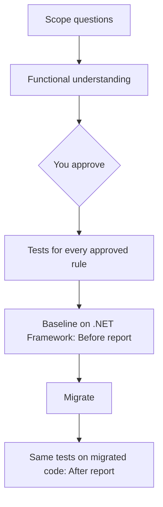

# Parity Proof

Early access Business and Enterprise

Parity Proof is a formal, client-reviewed process that shows a migration did not change behavior. You approve the business rules, every approved rule gets a test, and the same tests run on the old code and on the migrated code. You receive a report for each run.

!!! warning "Early access"
    Parity Proof is built and has been used on a real internal codebase. It is enabled per project and is recent. Talk to us about fit before relying on it for a regulated change. It is evidence for your review, not a guarantee.

## How it works

1. **Scope.** Forge asks a short set of questions with detected defaults: which solutions to cover, priority areas, external systems, test data, a coverage floor, the target runtime and the audience. Reply with numbered answers such as `3: Billing, Invoicing` or `7: 80%`. `/proceed` accepts the remaining defaults.
2. **Functional understanding.** The analyst writes the system's purpose, entry points, business rules with file and line references, data, integrations, and the places where the two runtimes are known to behave differently. You review it and can request up to three rounds of corrections. When you approve, it is locked with a hash.
3. **Tests.** Every approved rule gets a test, and every runtime-difference hotspot gets a probe. A rule with no test stops the run.
4. **Baseline (Before).** On a Windows runner the old code runs twice, with flaky tests quarantined. Coverage is measured. A sampled mutation score checks that the tests actually catch changes. A hashed set of expected results is stored. You get a **Before report** with a verdict of ready or ready with gaps.
5. **After.** The migrated code runs against the same locked tests. Each test is classified as a match, diverged, accepted difference, not comparable or flaky. You get an **After report** with a verdict of pass, pass with exceptions, or fail.
6. **Accepted differences.** A difference you decide to keep is recorded with a reason and an optional expiry date, and it appears in the report.

Report PDFs carry an ID and a SHA-256 hash so a later reader can confirm which run a document came from.

## Commands

| Command | What it does |
|---|---|
| `/parity-before` | Start Parity Proof Before on a repository. |
| `/proceed` | Confirm the scope, approve the understanding, or resume a stopped run. |
| `/parity-after` | Run the locked tests against the migrated code. |
| `/parity accept <rule or test> <reason>` | Record an accepted difference, optionally with `--expires YYYY-MM-DD`. |
| `/parity waive <reason>` | Waive the gate with a permanent audit record. The waiver is included in the evidence pack. |
| `/parity` | List the Parity Proof commands. |

Full options are in the [command reference](../reference/commands.md#parity-proof).

## Rules to know

- The test project must be byte-identical between Before and After. Any edit invalidates the run.
- A test that fails on both old and new counts as parity: the pinned bug is preserved.
- A test that passes on old and fails on new is a regression.
- Parity Proof works on a single repository at a time.
- The Windows runner image is provisioned by Forgestus.

## What it is not

Parity Proof is not a certification or an audit sign-off. It is a body of evidence, anchored in rules you approved, that your quality or compliance team can review and file. See [Certifications and roadmap](../security/certifications.md).
